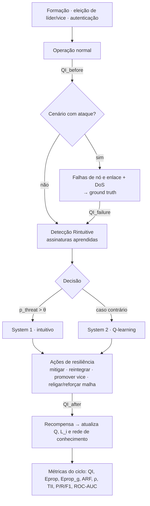

# INUIRT — Intuitive-based Resilient Topology

Emulador em Python/NetworkX usado para avaliar o framework **INUIRT — Intuitive-based Resilient Topology** num cenário IIoT de manufatura inteligente. O emulador gera topologias de rede sintéticas, injeta falhas de nó, falhas de enlace e ataques DoS a cada ciclo, e compara três cenários: rede sem ataque, rede atacada sem defesa e rede atacada protegida pelo motor intuitivo (detecção Rintuitive + decisão dual System 1/System 2 + ações de resiliência).

> Artigo associado: *Intuitive Resilient Topologies* — em revisão na Elsevier *Computer Communications*. A referência completa será adicionada após a publicação.

---

## Início rápido

```bash
git clone <url-do-repositorio> irt-simulator
cd irt-simulator
python -m venv .venv && source .venv/bin/activate   # Windows: .venv\Scripts\activate
pip install -r requirements.txt

python run_experiments.py                  # experimento completo do artigo (~10 min)
python run_experiments.py --runs 3 --cycles 5   # teste rápido (segundos)
python -m pytest tests/                    # confere a reprodutibilidade
```

Os resultados vão para `results/` (ver [Artefatos](#artefatos)).

---

## O que é emulado

Nenhum dataset externo é usado: rede, tráfego, falhas e ataques são sintéticos e gerados a partir de sementes fixas. Detalhes completos em [`docs/DADOS_EMULADOS.md`](docs/DADOS_EMULADOS.md).

| Elemento | Como é emulado |
|---|---|
| **Topologias** | Barabási–Albert (m = 2), Erdős–Rényi (p = 0.08), Watts–Strogatz (k = 6, p = 0.2), com 150 nós |
| **Nós** | tráfego, taxa de pacotes, latência (e sua EMA), energia, papel (membro/líder/vice), autenticação, vivo, sob ataque |
| **Enlaces** | qualidade U(0.7, 1.0) e capacidade U(1, 10) |
| **Operação normal** | fator de carga ~ N(1, 0.05) por ciclo sobre tráfego/pacotes/latência; drenagem de energia |
| **Falhas e ataques (por ciclo)** | 2 falhas de nó, 3 falhas de enlace, 3 novos nós em DoS (tráfego U(1.5, 7), latência U(28, 90) ms) |
| **Ground truth** | nós vivos sob DoS em cada ciclo |

### Cenários

| Cenário (`config` no CSV) | Ataques | Motor intuitivo | Defesa |
|---|:-:|:-:|:-:|
| `Baseline` | — | — | — |
| `Baseline+Ataque` | ✓ | — | — |
| `Ataque+Protecao` | ✓ | ✓ | ✓ |

Desenho experimental: **3 cenários × 3 topologias × 35 runs × 35 ciclos**. As mesmas 35 sementes (59, 76, 93, …) são usadas em todos os cenários e topologias, então as comparações são pareadas.

---

## Fluxo de um ciclo



Nos cenários sem motor intuitivo, as etapas de detecção, decisão e aprendizado são puladas.

---

## Estrutura do repositório

```
irt-simulator/
├── run_experiments.py      # ponto de entrada (CLI)
├── irt/
│   ├── config.py           # TODOS os parâmetros: escala, sementes, cenários, ataques, pesos
│   ├── topology.py         # geração de grafos + atributos emulados de nós/enlaces
│   ├── operations.py       # formação, eleição, autenticação, operação normal
│   ├── attacks.py          # falha de nó, falha de enlace, DoS, ground truth
│   ├── detection.py        # detecção intuitiva (Rintuitive)
│   ├── knowledge.py        # rede de conhecimento e memória de assinaturas
│   ├── learning.py         # aprendizado distribuído (estado L_i)
│   ├── dual_system.py      # System 1 / System 2 (Q-learning)
│   ├── resilience.py       # ações de resiliência
│   ├── metrics.py          # QI, Eprop, ARF (Eq. 6), ρ (Eq. 7), TII (Eq. 5), ROC-AUC (Eq. 14)
│   ├── cycle.py            # um ciclo completo (ordem das etapas)
│   ├── experiment.py       # laço topologia × run × ciclo e agregação por run
│   └── report.py           # tabelas comparativas
├── docs/
│   ├── DADOS_EMULADOS.md   # o que é sintetizado, distribuições, sementes
│   ├── METRICAS.md         # definição de cada métrica ↔ equação do artigo
│   └── ARTEFATOS.md        # dicionário de colunas do CSV e demais saídas
├── tests/
│   ├── test_reproducibility.py
│   └── reference_small.csv # saída de referência (2 runs × 4 ciclos)
├── results/                # saídas (não versionadas)
├── requirements.txt
└── .gitignore
```

---

## Artefatos

| Arquivo | Conteúdo |
|---|---|
| `results/resultados_modelo_irt.csv` | 315 linhas: uma por (cenário, topologia, run), com as médias dos 35 ciclos |
| `results/relatorio_comparativo.txt` | tabelas de qualidade de rede, detecção e mecanismo dual por topologia |
| `results/metadados_execucao.json` | parâmetros, sementes, versões das bibliotecas e tempo de execução |

Dicionário de colunas em [`docs/ARTEFATOS.md`](docs/ARTEFATOS.md); definições das métricas em [`docs/METRICAS.md`](docs/METRICAS.md).

---

## Reprodutibilidade

- Cada run re-semeia `random` e `numpy.random` e passa a mesma semente ao gerador do NetworkX.
- A ordem das etapas em `irt/cycle.py` define a sequência de números aleatórios consumidos; **mudar a ordem muda os resultados**, mesmo sem mudar a lógica.
- `tests/reference_small.csv` foi gerado pelo script monolítico original; o teste garante que a versão modular produz os mesmos números.
- Versões testadas: Python 3.13, NetworkX 3.7, NumPy 2.5, pandas 3.0, scikit-learn 1.9 (fixadas em `requirements.txt`). Outras versões de NetworkX/NumPy podem gerar grafos ou sorteios diferentes.
- Tempo de referência: ~10 min para o experimento completo, em um único núcleo.

Para mudar o experimento, edite apenas `irt/config.py` e registre a mudança no commit; o `metadados_execucao.json` de cada execução guarda os parâmetros usados.

---

## Licença

*A definir* (sugestão: MIT para o código).
